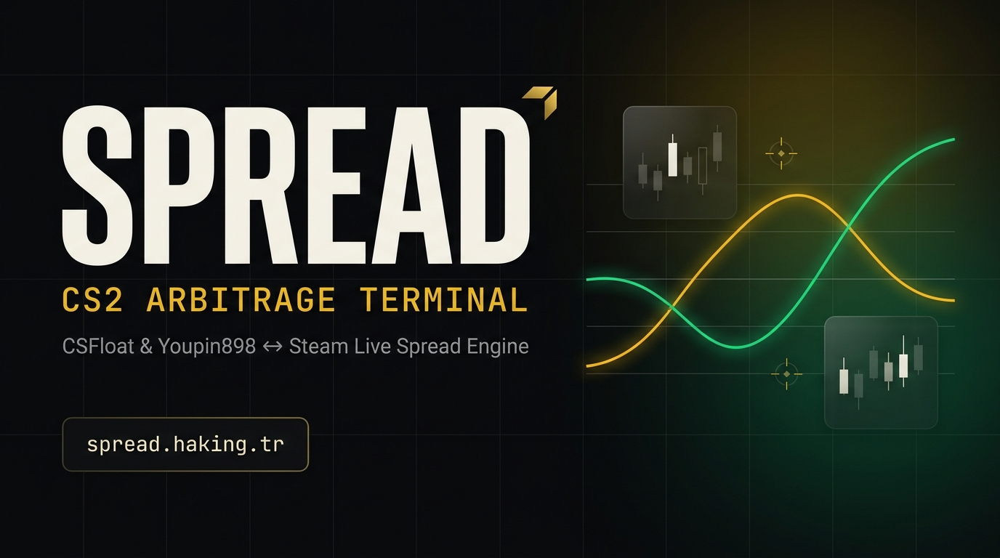

<div align="center">
  

  <h1>SPREAD — CS2 Arbitrage Terminal</h1>

  <p>
    <strong>CSFloat &amp; Youpin898 ↔ Steam Topluluk Pazarı</strong> için canlı veri destekli,
    gerçek Valve cent komisyon motorlu, 14 günlük iki yönlü CS2 arbitraj terminali.
  </p>

  <p>
    <a href="https://spread.haking.tr"><strong>spread.haking.tr</strong></a> ·
    <a href="#ozellikler">Özellikler</a> ·
    <a href="#kurulum-ve-yerel-calistirma">Yerel Çalıştırma</a> ·
    <a href="#cloudflare-pages-yayinlama">Cloudflare Pages Yayınlama</a> ·
    <a href="SECURITY.md">Güvenlik</a>
  </p>

  <p>
    
    
    
    
  </p>
</div>

---

## Nedir?

**SPREAD** (`spread.haking.tr`), Counter-Strike 2 skin ve kasa piyasasındaki **CSFloat** (birincil) ve **Youpin898** (opsiyonel) ile **Steam Topluluk Pazarı** arasındaki fiyat makasını (spread) canlı verilerle analiz eden, iki yönlü 14 günlük döngüleri (2 × 7 gün Trade Protection) kuruş hassasiyetinde hesaplayan ve tüm kullanıcı kayıtlarını **%100 yerel tarayıcı kasasında (JSON yedeklemeli)** saklayan açık kaynaklı bir arbitraj terminalidir.

---

## Özellikler

- **Canlı Piyasa Akışı & 4.500+ Gerçek CS2 Eşyası:**
  - Görsel ve nadirlik/aşınma kataloğu resmi oyun dosyalarını ayrıştıran [ByMykel/CSGO-API](https://github.com/ByMykel/CSGO-API) kaynağından senkronize edilir.
  - Canlı fiyatlar **CSFloat Public Price List** (`min_price` + gerçek ilan derinliği `quantity`), **CSFloat Buy Order** (`highest_order`), **Steam Community Market** (`24s / 7g / 30g / 90g`), **Youpin898** ve **open.er-api.com** (`USD / TRY / CNY / EUR`) kaynaklarından Cloudflare Pages Functions (`/api/market`, `/api/fx`) aracılığıyla CORS engeli olmadan çekilir.
- **Gerçekçi Kantitatif Matematik Motoru:**
  - **Gerçek Valve Cent Komisyonu:** Klasik `÷ 1.15` tahmininin yanında Valve'ın gerçek tam-cent kesinti kuralını (`max($0.01, floor(r × 0.05)) + max($0.01, floor(r × 0.10))`) çözer ve ucuz eşyalardaki minimum komisyon tuzağını anında uyarır.
  - **Nakit Eşdeğeri Portföy Değerlemesi:** Steam cüzdanında artan kalan bakiyeyi 1:1 nakit saymaz; `M₂` dönüşüm çarpanıyla iskonto ederek (`Nakit + Steam × M₂`) gerçekçi net kârı hesaplar.
  - **12 Döngülük Bileşik Grafik & 5×5 Risk Isı Haritası:** Sıfır harici kütüphane ile yazılmış yüksek DPI etkileşimli Canvas 2D grafikler.
- **Otomatik En İyi Çift Bulucu & Anti-Manipülasyon Koruması:**
  - Sermayenize uygun, yüksek likiditeli ve 24s/7g fiyat sapması temiz olan en kârlı 1. Yön + 2. Yön çiftlerini otomatik eşleştirir.
- **2 Fazlı 14 Günlük Döngü Takibi & Gerçekleşen Kâr Defteri:**
  - Canlı geri sayım, çoklu para birimlerinde kur normalizasyonu, Faz 2 bitiminde gerçekleşen (Actual vs Expected) kâr kaydı ve Excel güvenli CSV dışa aktarımı.
- **Arbitraj Akademisi:**
  - İki yönlü döngü mantığı, etkileşimli **Steam $0.01 Komisyon Tuzağı Laboratuvarı**, CSFloat vs Youpin898 karşılaştırması ve Temmuz 2025 Valve Trade Protection rehberi.
- **Sertleştirilmiş Güvenlik & Yerel JSON Veri Kasası:**
  - Sıfır `innerHTML`, sıfır inline script, katı CSP (`script-src 'self'`), SHA-256 doğrulamalı JSON yedekleme/geri yükleme (Birleştir veya Üzerine Yaz).

---

## Klasör Yapısı

```text
├── wrangler.toml               # Cloudflare Workers + Static Assets yapılandırması (name = "spread")
├── server.mjs                  # Sıfır bağımlılıklı yerel canlı geliştirme + API proxy sunucusu
├── src/
│   └── worker.js               # Cloudflare Worker (/api/market & /api/fx canlı Edge API + ASSETS)
├── public/                     # Yalnızca istemciye sunulan statik web dosyaları
│   ├── index.html              # CSP sertleştirilmiş ana giriş ve OpenGraph meta
│   ├── _headers                # Katı güvenlik başlıkları (CSP, HSTS, X-Frame-Options)
│   ├── _redirects              # Temiz URL yönlendirmeleri
│   ├── assets/brand/           # Gemini Banana ile üretilmiş logo, favicon ve 16:9 afiş
│   ├── css/                    # Modüler tasarım sistemi (tokens, base, layout, components, views)
│   ├── js/                     # Modüler ES uygulama (core, services, charts, views, main)
│   └── data/                   # Paketlenmiş 4.500+ CS2 eşya kataloğu ve çevrimdışı snapshot
└── scripts/
    ├── sync-catalog.mjs        # ByMykel/CSGO-API + canlı piyasa snapshot güncelleyici
    └── verify.mjs              # Sözdizimi, güvenlik (XSS/CSP) ve matematik doğrulama testi
```

---

## Kurulum ve Yerel Çalıştırma

Node.js **20+** dışında hiçbir harici paket (`npm install`) gerekmez.

```bash
# 1. Depoyu klonlayın
git clone https://github.com/<kullanici-adin>/SPREAD.git
cd SPREAD

# 2. (Opsiyonel) ByMykel/CSGO-API ve canlı piyasa önbelleğini tazeleyin
npm run sync

# 3. Yerel canlı sunucuyu başlatın (hem arayüz hem /api/market ve /api/fx canlı çalışır)
npm run dev
```

Tarayıcıda **`http://127.0.0.1:4173`** adresini açın.

Doğrulama testlerini çalıştırmak için:

```bash
npm run verify
```

---

## Cloudflare Workers (Static Assets) Yayınlama (`spread.haking.tr`)

Proje **GitHub → Cloudflare Workers Builds (`npx wrangler deploy`)** akışına birebir hazır yapılandırılmıştır:

1. Bu depoyu kendi GitHub hesabınıza gönderin (`main` dalı).
2. **Cloudflare Dashboard → Workers & Pages → Create → Workers → Connect to Git** adımından `SPREAD` reposunu seçin.
3. Worker adını **`spread`** (`wrangler.toml` ile eşleşir) bırakın; Build command boş, Deploy command varsayılan `npx wrangler deploy` olarak çalışır.
4. Yayınlandıktan sonra **Settings → Domains & Routes → Add Custom Domain** bölümünden **`spread.haking.tr`** alt alan adını ekleyin.
5. `src/worker.js` otomatik olarak `/api/market` ve `/api/fx` uç noktalarını Cloudflare Edge üzerinde canlı çalıştırır; `.assetsignore` kaynak/yapılandırma dosyalarını gizler ve `_headers` tüm güvenlik başlıklarını uygular.

---

## Klavye Kısayolları

| Kısayol | İşlev |
| :--- | :--- |
| `Ctrl + K` veya `/` | Hızlı 4.500+ CS2 Skin Arama Paleti |
| `1` / `2` / `3` / `4` | Döngü Masası / Canlı Tarayıcı / Aktif Döngüler / Akademi |
| `Esc` | Açık modalı veya arama paletini kapat |

---

## Yasal Uyarı & Lisans

Bu yazılım yalnızca hesaplama, analiz ve kişisel takip amacıyla hazırlanmıştır; finansal veya yatırım tavsiyesi değildir. Valve Corporation, Steam, Counter-Strike 2, CSFloat veya Youpin898 ile herhangi bir resmi ortaklığı bulunmamaktadır.

[MIT Lisansı](LICENSE) altında açık kaynak olarak sunulmuştur.
